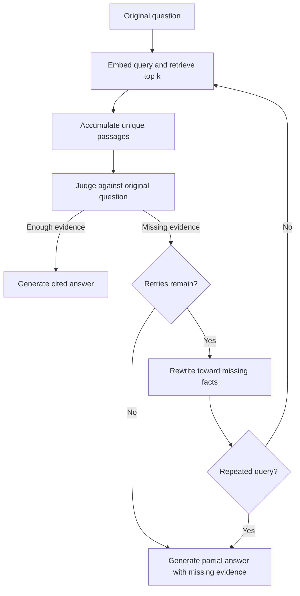

# Retrace — Recursive / Iterative Retrieval RAG

## Visual explanations

- [Iterative RAG concept](docs/visuals/iterative-rag-concept.png): evidence checking, query rewriting, and bounded retries.
- [Application flow](docs/visuals/application-flow.png): document ingestion, live Euri services, retrieval, and result inspection.
- [Image generation prompts](docs/visuals/image-prompts.md).

A live Euri RAG workbench with iterative query refinement and recursive subquestion retrieval. Inspired by [AIWITHKAUSHAL/Reranker-Rag](https://github.com/AIWITHKAUSHAL/Reranker-Rag), retaining its Euri endpoint and default model names. Both modes gather additional evidence rather than reranking a fixed pool.

## Run

Python 3.11+ and an Euri API key are required.

```sh
uv sync
cp .env.example .env
# Set EURI_API_KEY in .env, or enter it in the app sidebar.
uv run streamlit run app.py
```

Default endpoint: `https://api.euron.one/api/v1/euri`. Default models: `gemini-embedding-001` and `gemini-3.5-flash-lite`, matching the reference. Override them with the environment variables in `.env.example` if your account uses different model IDs. All embeddings, sufficiency judgments, rewrites and answers use live Euri calls. There is no hidden offline fallback. Provider errors are shown without raw request bodies or keys.

Upload UTF-8 `.txt` / `.md` files or use the included fictional handbook. Each upload is limited to 1 MB and the corpus to 200 chunks. Uploaded text, questions and retrieved passages are transmitted to Euri. Keys are never included in downloaded traces.

## Iterative retrieval flow



`max_retries` means additional searches after the initial attempt: total searches never exceed `1 + max_retries` (at most six). A repeated query also stops the loop. Setting retries to zero gives a one-shot run. The judge always sees the original question and accumulated evidence, so rewrites cannot redefine the question. Context is deduplicated by stable chunk ID and is bounded by `(1 + max_retries) * top_k` passages.

Each attempt displays its search query, ranked results, cosine scores, evidence judgment, missing facts and accumulated context IDs. The app also displays the original question, final context, stop reason and cited answer, with JSON export. A failed provider call ends the run explicitly rather than claiming success.

## Recursive retrieval

Both approaches are available in the sidebar; iterative remains the default. `Pipeline.run_recursive()` searches the original question at depth zero. If unresolved, the provider decomposes it into up to three focused subquestions. An inner `visit()` function recursively searches unresolved children depth-first, sharing unique evidence across branches. A solved local subquestion returns to its parent. Only a sufficiency judgment against the original question can mark the whole run complete.

Defaults: `max_depth=2`, `max_searches=6`, `top_k=1`. Depth is bounded to 0-4, total searches to 1-20, and passages per search to 1-10. The budget is shared across the entire tree, so context is bounded by `min(corpus_size, max_searches * top_k)`. Case-insensitive repeated queries are skipped globally while other branches continue. Depth zero or a one-search budget gives a one-shot run.

The trace shows node IDs, parent IDs, depth, children, status, and local plus original-question assessments. Stops include `sufficient_evidence`, `search_limit`, `depth_limit`, `repeated_query`, and `decomposition_exhausted`. When multiple limits occur, the overall reason prioritizes success, search limit, depth limit, then repeats. Incomplete runs generate a partial answer; provider failures are explicit errors. Decomposition and local checks add model calls, latency, and cost. The existing concept image illustrates iterative mode; the app also displays the recursive tree.

```python
pipeline.run(question, max_retries=3, top_k=1)  # iterative: at most four searches
pipeline.run_recursive(question, max_depth=2, max_searches=4, top_k=1)
```

## Demonstration

Use the default question with **one passage per attempt**:

> Can an Atlas employee who joined 20 days ago work remotely from Lisbon for 20 days, and who must approve it?

The required evidence spans `H001` (Lisbon, 30-day limit, manager and People Operations approval) and `H002` (90-day probation and ineligibility). One result cannot contain both. A good subsequent query targets whichever policy is missing. Expected conclusion: this employee is currently ineligible; after probation, a request requires manager and People Operations approval.

```sh
uv run python evaluate.py
uv run python evaluate.py --mode recursive
```

This writes a fresh live trace to `reports/live-demo.json`, including first-attempt and final recall against the two human-labelled evidence IDs. Improvement is measured honestly and is not guaranteed by model behavior. A larger accumulated context budget contributes to the improvement; this is a demonstration of evidence recovery, not a controlled claim that rewriting alone beats larger one-shot retrieval. A local live verification recovered both required passages: first-attempt evidence recall 0.5, final evidence recall 1.0. Run the command to generate your own trace; reports are ignored by Git by default.

Recursive evaluation writes `reports/live-demo-recursive.json`; both evaluation modes use at most four searches. These are individual live runs, not a controlled quality comparison.

## Tests and files

```sh
python3 -m unittest discover -s tests -v
```

Tests use an explicitly labelled fake provider to verify missing-evidence recovery, early success, retry bounds, repeated queries, input validation and unknown citations. They do not validate live model quality.

- `rag.py`: Euri client, cosine retrieval, evidence check, rewrite and loop.
- `app.py`: interactive inspection and trace export.
- `evaluate.py`: live evidence-recovery measurement.
- `data/handbook.json`: fictional demonstration corpus.
- `docs/VIDEO_SCRIPT.md`: recording walkthrough and submission instructions.

Model judgments can be wrong, and accumulated irrelevant passages may distract generation. Grounding prompts and citation validation reduce some errors but do not prove every claim is entailed. The implementation uses an in-memory index rebuilt per run, with no database or external vector service required.

## HTTP 403 troubleshooting

Evidence assessments tolerate missing-fact lists or null values and bracketed chunk IDs. Other invalid assessments trigger one fresh assessment with schema feedback and the allowed chunk IDs. A second invalid response ends the run with a field-specific error; unknown evidence IDs are never silently accepted. This format retry is separate from the retrieval search budget and can add one model call per assessment.

The Euri gateway can reject Python urllib’s default User-Agent with HTTP 403 and `error code: 1010`. The client explicitly identifies itself as `Retrace-RAG/0.1`; this resolved the reproduced gateway rejection with the same key and model. Other 403 responses may indicate account or model permissions. Errors include the request stage and model without exposing response bodies or credentials. After updating the client, refresh the running Streamlit app and start a new run.
